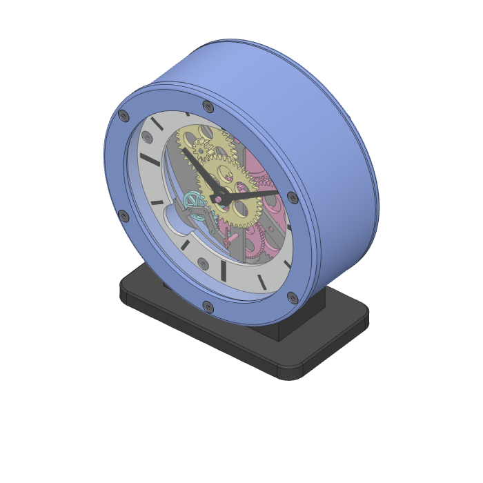
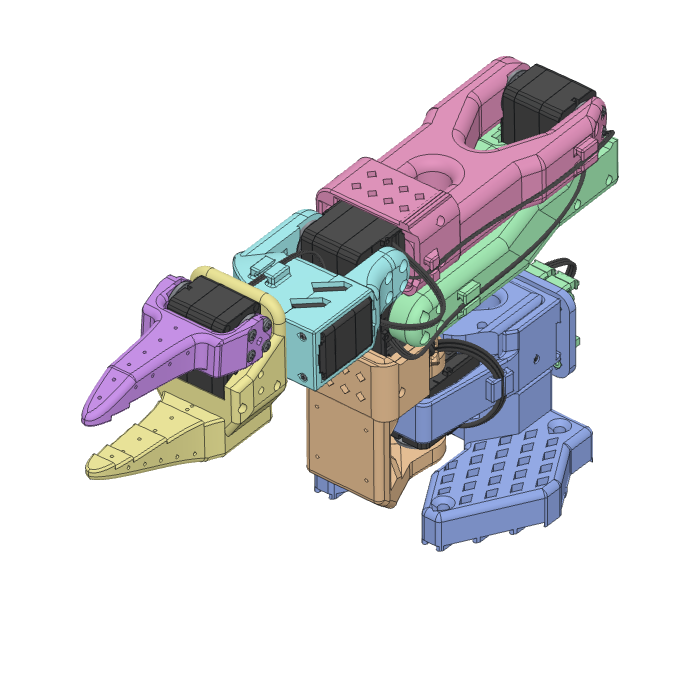
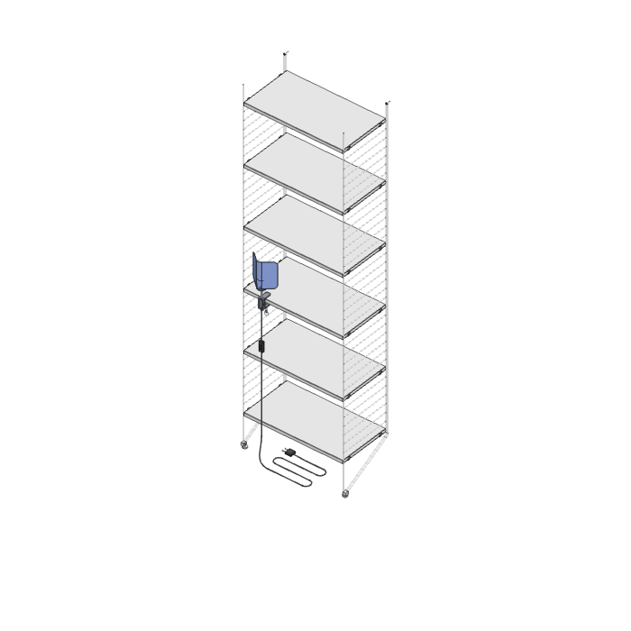
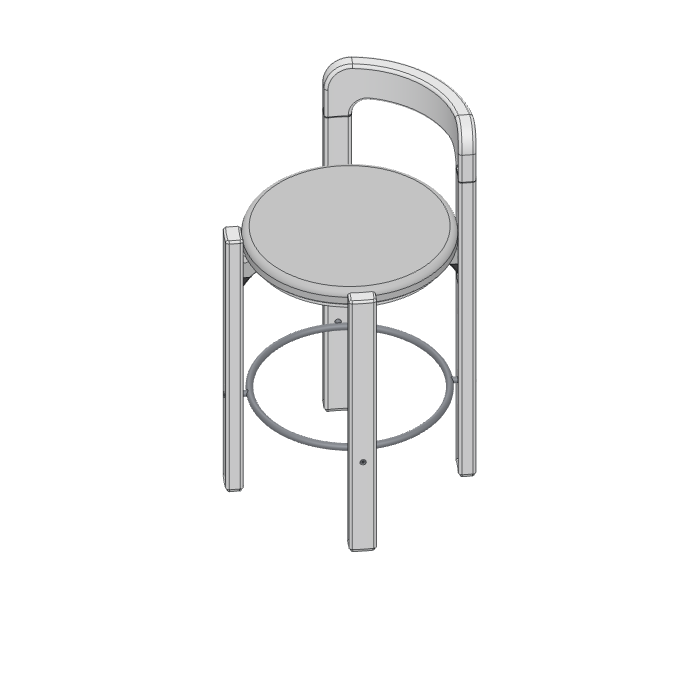

# Enclose

A desktop workbench for CAD projects that are built from code
([enclose.dev](https://enclose.dev)). You look at the model in 3D, click the part you
mean, say what should change, and Claude edits the project and rebuilds it. The view
reloads by itself.

It does not replace a sketching tool. The idea is to draw the first shape wherever you
like (Shapr3D, for one), export it, and iterate from there in code with Claude.

<p align="center">
  
  
  
  
</p>

Early days: it runs from source, on macOS. See [Not there yet](#not-there-yet).

## What it does

- **Starts from anything.** An empty folder and a sentence, a STEP file from the tool
  you sketch in, or one of the four examples above.
- **Takes what you point at.** Click a part, or draw a box round several, and say what
  should change there. Claude is told which part, and where on it you clicked.
- **Shows the inside.** Cut the model open, pull it apart, see through its shell, find a
  part by name.
- **Shows the real size.** Set the model on a desk, in a room or beside a person.
- **Hands out drawings and files.** Blueprints as SVG with the model's own layers, and
  STEP of the whole model, a group or one part.
- **Grows tools for your model.** Ask to see the model do something (a clock run, a lid
  open, an arm move) and Claude builds the controls for it.
- **Takes a change back.** Cmd+Z undoes a whole turn of Claude's at once, without
  building anything.

Claude is the Claude Code already on your machine. The app has no login of its own and
stores no credentials.

## Run it

You need Node 22 or newer and, for the conversation,
[Claude Code](https://code.claude.com/docs/en/overview) installed and signed in. Models
are built with Python and [build123d](https://build123d.readthedocs.io); where build123d
is missing, Claude makes a virtual environment for it in the project's folder.

```
cd apps/desktop
npm install
npm run dev                      # open the app
npm run dev -- path/to/project   # ...with that folder, or STEP file, opened as a project
```

`npm run build && npm start` runs the production build instead of the dev loop.

## Not there yet

- No installer. It runs from a checkout.
- Of CAD files it opens only STEP. Meshes (STL, OBJ, 3MF) are not brought in: they could
  be shown, but there is no solid in them for Claude to change.
- Only tried on macOS.

## Documentation

The rest is in [docs/](docs), a page to a subject.

- [Projects](docs/projects.md): starting from nothing, an example or CAD files
- [The view](docs/view.md): moving around, set views and shading
- [Picking parts out](docs/selecting.md)
- [Parts and groups](docs/parts.md)
- [Section, explode and grid](docs/section-explode-grid.md)
- [Reference scenes](docs/reference-scenes.md)
- [Blueprints](docs/blueprints.md)
- [Tools of a project's own](docs/project-tools.md)
- [Working with Claude](docs/working-with-claude.md)
- [Writing a message](docs/messages.md)
- [Screws](docs/screws.md)
- [Keyboard shortcuts](docs/shortcuts.md)
- [Settings](docs/settings.md)

Working on the app itself? Start at [docs/development.md](docs/development.md).

## Contributing

Fixes and ideas are welcome: [CONTRIBUTING.md](CONTRIBUTING.md) says how.

## License

Copyright (C) 2026 Glauber

Enclose is free software: you can redistribute it and/or modify it under the terms of
the GNU Affero General Public License, version 3, as published by the Free Software
Foundation. It is distributed in the hope that it will be useful, but WITHOUT ANY
WARRANTY; without even the implied warranty of MERCHANTABILITY or FITNESS FOR A
PARTICULAR PURPOSE. The whole of it is in [LICENSE](LICENSE).

In short: use it, change it and pass it on, for anything. Whatever you pass on, or run
as a service for others, goes with its full source and under this same license, your
changes included.

Additional permission under GNU AGPL version 3 section 7: if you modify this Program,
or any covered work, by linking or combining it with the Claude Agent SDK
(`@anthropic-ai/claude-agent-sdk`), or a modified version of that library, containing
parts covered by the terms of that library's own license, the licensors of this Program
grant you additional permission to convey the resulting work.

The name Enclose and its mark are not licensed with the code. A fork goes by a name and
a mark of its own.

Some of what is here came from others, and stays under their terms:

- [`apps/desktop/src/components/ui`](apps/desktop/src/components/ui) began as [shadcn/ui](https://ui.shadcn.com)'s
  components (MIT).
- [`examples/arm/source`](examples/arm/source) is the SO-101 arm's own CAD file, by
  TheRobotStudio (Apache 2.0): its [README](examples/arm/source/README.md) says more.
- The figure of a person that stands in the reference scenes is made from Blender
  Studio's Human Base Meshes (CC0): [`kit/figure`](kit/figure) says how.
